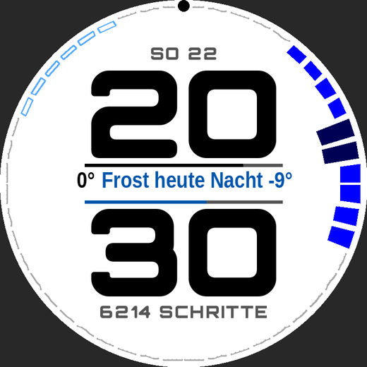
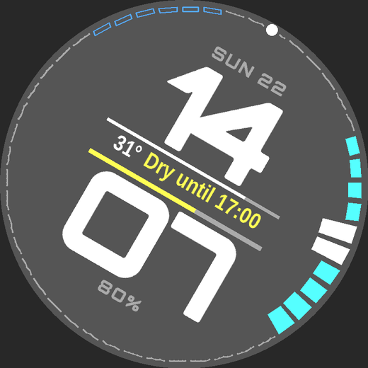
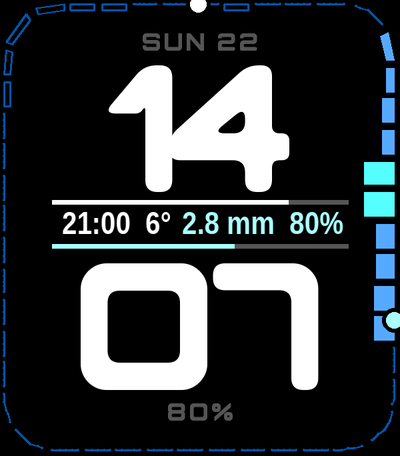

# Contour

A minimal Pebble watchface: the next hours of rain drawn as a
blue bar chart around a big, clean stacked clock. Built for Pebble Time 2
(`emery`) and Pebble Round 2 (`gabbro`).

| Round 2 | Round 2, Daylight | Round 2, tilted 30° | Time 2 | Time 2, wrist flick |
|---|---|---|---|---|
|  |  |  |  |  |

_The previews use a made-up forecast and come from the host test harness in `tools/preview` with stand-in
fonts, so the lettering differs a little from the watch._

## How to read it

- **A blue bar chart** runs all the way round the edge in 30-minute slots,
  starting at the dot at the top (now) and running clockwise. Round 2 shows
  24 hours. On Time 2 you can choose 12, 24 or 48 hours.
- **Dry slots** are faint dashes along the edge, so every half hour is visible
  even without rain. **Rainy slots** grow a bar inward instead: the longer the
  bar, the more rain (full length at 4 mm/h). The next two hours use
  Open-Meteo's 15-minute data, and later slots use the hourly forecast.
- **Colour grades the amount**, so you can tell at a glance:

  | Theme | light (< 1 mm/h) | medium (1 to 4 mm/h) | heavy (4 mm/h or more) |
  |---|---|---|---|
  | Midnight | cobalt blue | picton blue | electric blue (bright cyan) |
  | Daylight | picton blue | blue | dark navy |
  | Graphite | picton blue | electric blue | white |
  | Mono | dark grey | light grey | white |

- **Solid bars** mean rain is likely (50 % or more). **Outlined bars** mean it
  is unlikely.
- **Rain amounts**: when rain is coming, the smart line adds the heaviest
  hour of the spell, like `Rain in 45 min · 2.8 mm`.
- **Battery line and step bar**: a thin line just above the middle text shows the watch battery: plain (red at 20% or less) or colourful (green, orange below 30%, red below 10%), and a bar just below it fills towards your step goal (a fixed goal or your usual day from Pebble Health). Both can be turned off.
- **Clock**: big bold stacked hours over minutes in a wide, square "techno" style (Contour Digits, a modified Orbitron Black), as large as fits inside the rain chart. The date and the extra line use small capitals of the same font, with the
  date small above. Between them is a thin info row with the temperature and
  the smart line, and a bottom line (by default today's low, the temperature now in bright and today's high; or battery, steps or heart rate)
  sits below.
- **Wrist flick**: a cursor walks along the line, and the middle shows the
  time, temperature and rain for each hour.
- **Colour palettes**: Midnight, Daylight, Mono, Graphite, Ocean, Forest, Ember, Sand, or Automatic. The step line colour can be picked separately.
- **Rain warning**: optional short double buzz 15, 30 or 60 minutes before rain starts, once per shower, silent in Quiet Time.
- **Own colours**: optional text and accent colour pickers on top of any palette (not Mono).
- **Tilt**: the whole face can be turned (15° steps up to 90° either way, or
  upside down) for wearing the watch on the inside of the wrist or reading it
  at an angle. The line follows the screen edge and starts where "up" now is.

### Smart line

It shows the most important thing, in this order: rain now (until when) or
rain within 2 hours (from 15-minute data), frost tonight, wind gusts, UV,
"dry until", and then the next sunset or sunrise. When none of those apply, it
shows the high and low.

## Settings

All of these are set from the phone app:

- **Look**: theme (Midnight, Daylight, Mono, Graphite, or Automatic, which is
  Daylight by day and Midnight at night), tilt, line length on Time 2, the
  extra line, battery line, step goal bar and goal, and animations.
- **Smart line**: frost tonight, the wind gust threshold, the UV threshold, and
  sunset/sunrise.
- **Language and units**: English, Deutsch, Français, Italiano or Español;
  12 or 24 hour clock; °C or °F; mm or inch; km/h, mph, m/s, knots or Beaufort.
- **Weather**: updates on or off, how often to update (15, 30 or 60 min), the
  weather model (best match, MeteoSwiss, DWD ICON, ECMWF, Météo-France,
  UK Met Office, GFS), and the location (phone GPS or a city name).

Temperature, sky and the smart line are in the middle. Weather comes from [Open-Meteo](https://open-meteo.com), which needs no
account or API key. The watch stores 72 hours, so the line keeps working when
your phone is away. Updates and animations pause below 20 % battery, and
animations also pause in Quiet Time.

## Build and install

You need the Pebble SDK (`pebble-tool`):

```sh
uv tool install pebble-tool      # or: pip install pebble-tool
pebble sdk install latest
cd minimal-weather-face
pebble build
pebble install --emulator emery            # try it in the emulator
pebble install --phone <your phone's IP>   # or install it on the watch
```

`pebble build` fetches the settings page library (`pebble-clay`) through npm,
which is why npm must be installed.

## Code layout

| Path | What it does |
|---|---|
| `src/c/main.c` | Watch app: storage, messages from the phone, ticks, battery, health, animations |
| `src/c/draw.c` | Draws the rain bars and the stacked clock |
| `src/c/tilt.c` | Turns the face when a tilt is set |
| `src/c/text.c` | Translations, units, and the smart line |
| `src/c/weather.c` | Small helpers for the stored forecast |
| `src/pkjs/index.js` | Phone side: location, Open-Meteo request, sending data to the watch |
| `src/pkjs/config.js` | The settings page |
| `tools/preview/` | Host harness: `stub.c` runs the real drawing code, `render.py` turns it into PNGs, `make_previews.sh` rebuilds `docs/` |
| `tools/test_pack.js` | Node check of the phone-side data packing (`node tools/test_pack.js`) |
