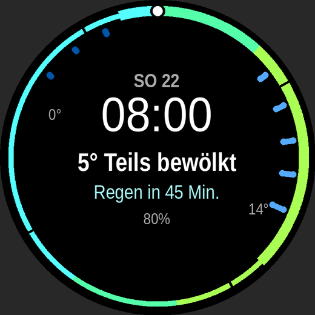
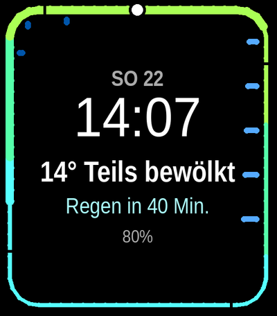

# Contour

A minimal Pebble watchface: the next hours of weather drawn as one thin line
around the time. Built for Pebble Time 2 (`emery`) and Pebble Round 2 (`gabbro`).

| Round 2 | Round 2, Daylight | Time 2 | Time 2, wrist flick |
|---|---|---|---|
|  |  |  |  |

_The previews come from the host test harness in `tools/preview` with stand-in
fonts, so the lettering differs a little from the watch._

## How to read it

- **The track** starts at the top dot (now) and runs clockwise. Round 2 shows
  24 hours. On Time 2 you can choose 12, 24 or 48 hours.
- **Colour** is the temperature: violet and blue when it's cold, through green
  and yellow, to orange and red when it's hot.
- **Thickness**: the track is thinner at night.
- **Bars inside the track** are rain. Longer bars mean more rain, and paler bars
  mean it's less likely.
- **Notches** mark 00, 06, 12 and 18 o'clock. The midnight one is deeper.
- **Round 2 only**: small numbers show the high and low of the next 24 hours.
- **Middle**: the date, the time, the current temperature and sky, then a
  smart line, then an optional extra line (battery, steps or heart rate).
- **Wrist flick**: a cursor walks round the track, and the middle shows the
  time, temperature and rain for each hour.

### Smart line

It shows the most important thing, in this order: rain now (until when) or
rain within 2 hours (from 15-minute data), frost tonight, wind gusts, UV,
"dry until", and then the next sunset or sunrise. When none of those apply, it
shows the high and low.

## Settings

All of these are set from the phone app:

- **Look**: theme (Midnight, Daylight, Mono, Graphite, or Automatic, which is
  Daylight by day and Midnight at night), track length on Time 2, the extra
  line, and animations.
- **Smart line**: frost tonight, the wind gust threshold, the UV threshold, and
  sunset/sunrise.
- **Language and units**: English, Deutsch, Français, Italiano or Español;
  12 or 24 hour clock; °C or °F; mm or inch; km/h, mph, m/s, knots or Beaufort.
- **Weather**: updates on or off, how often to update (15, 30 or 60 min), the
  weather model (best match, MeteoSwiss, DWD ICON, ECMWF, Météo-France,
  UK Met Office, GFS), and the location (phone GPS or a city name).

Weather comes from [Open-Meteo](https://open-meteo.com), which needs no
account or API key. The watch stores 72 hours, so the track keeps working when
your phone is away. Updates and animations pause below 20 % battery, and
animations also pause in Quiet Time.

## Build and install

You need the Pebble SDK (`pebble-tool`):

```sh
uv tool install pebble-tool      # or: pip install pebble-tool
pebble sdk install latest
cd minimal-weather-face
pebble build
pebble install --emulator emery            # try it in the emulator
pebble install --phone <your phone's IP>   # or install it on the watch
```

`pebble build` fetches the settings page library (`pebble-clay`) through npm,
which is why npm must be installed.

## Code layout

| Path | What it does |
|---|---|
| `src/c/main.c` | Watch app: storage, messages from the phone, ticks, battery, health, animations |
| `src/c/draw.c` | Draws the track and the text |
| `src/c/text.c` | Translations, units, and the smart line |
| `src/c/weather.c` | Small helpers for the stored forecast |
| `src/pkjs/index.js` | Phone side: location, Open-Meteo request, sending data to the watch |
| `src/pkjs/config.js` | The settings page |
| `tools/preview/` | Host harness: `stub.c` runs the real drawing code, and `render.py` turns the output into PNGs |
| `tools/test_pack.js` | Node check of the phone-side data packing (`node tools/test_pack.js`) |
